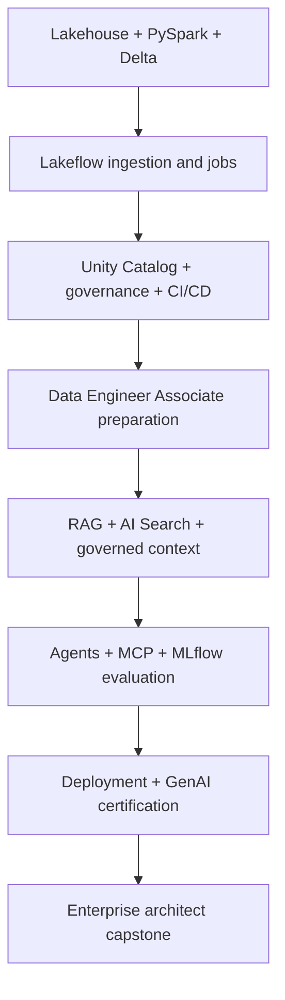

# Databricks Data & AI Engineering — 8-Week Intensive Bootcamp

> **English first · [繁體中文在下](#traditional-chinese)**  
> 8 weeks · 56 daily lessons · 120 hours · Official Databricks training and certification readiness

  

A practical, open-source roadmap for building enterprise Databricks **data pipelines, governed lakehouses, AI retrieval and production AI agents**. Designed for data analysts/engineers entering data-and-AI consulting, with optional Claude integration.

**Suggested schedule:** October 26 – December 20, 2026 (start any time).  
**Workload:** 15 hours/week — weekdays 2h, Saturday 4h, Sunday 1h.

## Learning architecture

## Weekly curriculum

| Week | Focus | Output | Link |
|---|---|---|---|
| 1 | Lakehouse, SQL and PySpark Fundamentals | Weekly lab + review | [Week 1](curriculum/week-01.md) |
| 2 | Lakeflow Ingestion, Pipelines and Orchestration | Weekly lab + review | [Week 2](curriculum/week-02.md) |
| 3 | Unity Catalog, Performance and CI/CD | Weekly lab + review | [Week 3](curriculum/week-03.md) |
| 4 | Data Engineer Associate Certification Sprint | Weekly lab + review | [Week 4](curriculum/week-04.md) |
| 5 | GenAI, RAG and Governed Retrieval | Weekly lab + review | [Week 5](curriculum/week-05.md) |
| 6 | Agents, MCP, MLflow and Agent Evaluation | Weekly lab + review | [Week 6](curriculum/week-06.md) |
| 7 | GenAI Deployment and Certification Sprint | Weekly lab + review | [Week 7](curriculum/week-07.md) |
| 8 | Enterprise Architecture and Final Capstone | Weekly lab + review | [Week 8](curriculum/week-08.md) |

## All 56 daily lessons

| Day | Topic |
|---|---|
| 01 | [Workspace, compute and SQL warehouses](curriculum/day-01.md) |
| 02 | [Lakehouse and Medallion architecture](curriculum/day-02.md) |
| 03 | [PySpark DataFrame operations](curriculum/day-03.md) |
| 04 | [Delta Lake reliability](curriculum/day-04.md) |
| 05 | [Databricks SQL and query plans](curriculum/day-05.md) |
| 06 | [Week 1 Medallion pipeline lab](curriculum/day-06.md) |
| 07 | [Week 1 review and architecture defense](curriculum/day-07.md) |
| 08 | [Incremental ingestion and Auto Loader](curriculum/day-08.md) |
| 09 | [Lakeflow Connect and ingestion design](curriculum/day-09.md) |
| 10 | [Declarative pipelines and expectations](curriculum/day-10.md) |
| 11 | [Lakeflow Jobs orchestration](curriculum/day-11.md) |
| 12 | [Schema evolution and quarantine](curriculum/day-12.md) |
| 13 | [Incremental ETL production lab](curriculum/day-13.md) |
| 14 | [Week 2 incident simulation](curriculum/day-14.md) |
| 15 | [Unity Catalog object model](curriculum/day-15.md) |
| 16 | [Governance, lineage and RBAC](curriculum/day-16.md) |
| 17 | [Sensitive data and row/column restrictions](curriculum/day-17.md) |
| 18 | [Spark execution and performance](curriculum/day-18.md) |
| 19 | [Bundles and Git-based deployment](curriculum/day-19.md) |
| 20 | [Governed pipeline challenge](curriculum/day-20.md) |
| 21 | [DE Associate gap check](curriculum/day-21.md) |
| 22 | [Exam domain: platform and ingestion](curriculum/day-22.md) |
| 23 | [Exam domain: transformation and modeling](curriculum/day-23.md) |
| 24 | [Exam domain: Lakeflow orchestration](curriculum/day-24.md) |
| 25 | [Exam domain: governance and CI/CD](curriculum/day-25.md) |
| 26 | [Timed readiness exercise](curriculum/day-26.md) |
| 27 | [Production pipeline code review](curriculum/day-27.md) |
| 28 | [Voucher and exam readiness review](curriculum/day-28.md) |
| 29 | [GenAI platform and model serving](curriculum/day-29.md) |
| 30 | [Document parsing and chunking](curriculum/day-30.md) |
| 31 | [Embeddings and vector retrieval](curriculum/day-31.md) |
| 32 | [Hybrid search and reranking](curriculum/day-32.md) |
| 33 | [RAG, citations and structured data](curriculum/day-33.md) |
| 34 | [Governed finance RAG integration lab](curriculum/day-34.md) |
| 35 | [Retrieval evaluation review](curriculum/day-35.md) |
| 36 | [Agent orchestration and tool calling](curriculum/day-36.md) |
| 37 | [MCP and Unity Catalog tool boundaries](curriculum/day-37.md) |
| 38 | [MLflow experiments and agent traces](curriculum/day-38.md) |
| 39 | [Evaluation datasets and graders](curriculum/day-39.md) |
| 40 | [AI Gateway, governance and operations](curriculum/day-40.md) |
| 41 | [Agent integration challenge](curriculum/day-41.md) |
| 42 | [Architecture comparison Claude vs Databricks](curriculum/day-42.md) |
| 43 | [Serving APIs and identity](curriculum/day-43.md) |
| 44 | [Development, staging and release gates](curriculum/day-44.md) |
| 45 | [Monitoring, latency and cost](curriculum/day-45.md) |
| 46 | [AI security and approval controls](curriculum/day-46.md) |
| 47 | [GenAI Associate readiness](curriculum/day-47.md) |
| 48 | [Live production-style agent demo](curriculum/day-48.md) |
| 49 | [Voucher process and exam checkpoint](curriculum/day-49.md) |
| 50 | [Lakehouse architecture and workload design](curriculum/day-50.md) |
| 51 | [Context engineering and agent memory](curriculum/day-51.md) |
| 52 | [Enterprise security and tenant boundaries](curriculum/day-52.md) |
| 53 | [Performance, FinOps and SLA planning](curriculum/day-53.md) |
| 54 | [Client architecture and delivery pack](curriculum/day-54.md) |
| 55 | [Final end-to-end architecture demo](curriculum/day-55.md) |
| 56 | [Next certifications roadmap](curriculum/day-56.md) |

Each daily guide contains assigned learning-path topics, **direct official documentation links**, precise labs, a timetable and a testable deliverable. For gated Partner Academy lessons, use your employer login and navigate to the named learning pathway; private lesson URLs are not fabricated.

## Credentials and corporate process

- **Company-announced:** Data Engineer Associate, Data Engineer Professional, Generative AI Engineering certification.
- **Recommended additional:** Context Engineer Associate, AWS Platform Architect **Accreditation**, and optionally ML Engineer Associate.
- See [certification roadmap and Workday / Co-Lab / voucher steps](docs/certifications.md). Company voucher availability for additional credentials is **not confirmed**.
- [Databricks certification catalog](https://www.databricks.com/learn/training/certification) · [Official training pathways](https://www.databricks.com/learn/training/home).

## Project and tracking

- [Governed Financial Lakehouse + AI Agent capstone](docs/capstone.md)
- [Daily progress checklist](docs/progress-tracker.md)
- [Architecture and security](docs/architecture.md)
- [Assessment rubric](docs/assessment.md)
- [15-hour weekly routine](docs/study-routine.md)

> Independent study material; **not endorsed or certified by Databricks or Accenture**. Use public/synthetic data only. Partner Academy may require an approved company account. Study goals and target weeks do not guarantee passing or exam availability.

---

# Databricks Data & AI Engineering — 八週高強度實戰訓練

> **繁體中文** · 8 週 · 56 天每日課表 · 120 小時 · Databricks 官方課程與專業認證準備

這是一份開源、以實作為核心的 Databricks 學習計畫，涵蓋 **Lakehouse、Spark、Delta、Lakeflow、Unity Catalog、RAG、MLflow、AI Agent 和企業部署**。也可以與原本的 Claude Bootcamp 結合，但兩套學習計畫的時數必須合理安排。

**建議日期：** 2026/10/26–12/20，可隨時開始。**每週 15 小時：** 平日每日 2 小時、週六 4 小時、週日 1 小時。

## 每週總覽

| 週次 | 學習主題 | 每週目標 | 連結 |
|---|---|---|---|
| 1 | Lakehouse、SQL 與 PySpark 基礎 | 實戰 Lab + 驗收 | [Week 1](curriculum/week-01.md) |
| 2 | Lakeflow 匯入、Pipelines 與工作排程 | 實戰 Lab + 驗收 | [Week 2](curriculum/week-02.md) |
| 3 | Unity Catalog、效能與 CI/CD | 實戰 Lab + 驗收 | [Week 3](curriculum/week-03.md) |
| 4 | Data Engineer Associate 認證衝刺 | 實戰 Lab + 驗收 | [Week 4](curriculum/week-04.md) |
| 5 | GenAI、RAG 與受治理檢索 | 實戰 Lab + 驗收 | [Week 5](curriculum/week-05.md) |
| 6 | Agents、MCP、MLflow 與 Agent Evaluation | 實戰 Lab + 驗收 | [Week 6](curriculum/week-06.md) |
| 7 | GenAI 部署與認證衝刺 | 實戰 Lab + 驗收 | [Week 7](curriculum/week-07.md) |
| 8 | Enterprise Architecture 與最終 Capstone | 實戰 Lab + 驗收 | [Week 8](curriculum/week-08.md) |

## 56 天完整課表

| Day | 主題 |
|---|---|
| 01 | [Workspace、Compute 與 SQL Warehouse](curriculum/day-01.md) |
| 02 | [Lakehouse 與 Medallion 架構](curriculum/day-02.md) |
| 03 | [PySpark DataFrame 操作](curriculum/day-03.md) |
| 04 | [Delta Lake 可靠性](curriculum/day-04.md) |
| 05 | [Databricks SQL 與查詢計畫](curriculum/day-05.md) |
| 06 | [第一週 Medallion Pipeline 實作](curriculum/day-06.md) |
| 07 | [第一週複習與架構答辯](curriculum/day-07.md) |
| 08 | [增量匯入與 Auto Loader](curriculum/day-08.md) |
| 09 | [Lakeflow Connect 與匯入架構](curriculum/day-09.md) |
| 10 | [Declarative Pipelines 與資料品質規則](curriculum/day-10.md) |
| 11 | [Lakeflow Jobs 工作排程](curriculum/day-11.md) |
| 12 | [Schema Evolution 與隔離區](curriculum/day-12.md) |
| 13 | [增量 ETL 上線模擬](curriculum/day-13.md) |
| 14 | [第二週故障演練](curriculum/day-14.md) |
| 15 | [Unity Catalog 物件模型](curriculum/day-15.md) |
| 16 | [治理、Lineage 與 RBAC](curriculum/day-16.md) |
| 17 | [敏感資料與行列權限](curriculum/day-17.md) |
| 18 | [Spark 執行效能](curriculum/day-18.md) |
| 19 | [Bundles 與 Git 部署](curriculum/day-19.md) |
| 20 | [受治理 Pipeline 挑戰](curriculum/day-20.md) |
| 21 | [Data Engineer Associate 能力盤點](curriculum/day-21.md) |
| 22 | [考綱：平台與資料匯入](curriculum/day-22.md) |
| 23 | [考綱：轉換與資料模型](curriculum/day-23.md) |
| 24 | [考綱：Lakeflow 工作排程](curriculum/day-24.md) |
| 25 | [考綱：治理與 CI/CD](curriculum/day-25.md) |
| 26 | [限時應試能力評估](curriculum/day-26.md) |
| 27 | [Production Pipeline 程式碼審查](curriculum/day-27.md) |
| 28 | [Voucher 與認證準備確認](curriculum/day-28.md) |
| 29 | [GenAI 平台與模型服務](curriculum/day-29.md) |
| 30 | [文件解析與切塊](curriculum/day-30.md) |
| 31 | [Embeddings 與向量檢索](curriculum/day-31.md) |
| 32 | [Hybrid Search 與重排序](curriculum/day-32.md) |
| 33 | [RAG、來源引用與結構化資料](curriculum/day-33.md) |
| 34 | [受治理金融 RAG 實作](curriculum/day-34.md) |
| 35 | [檢索評估與回顧](curriculum/day-35.md) |
| 36 | [Agent 協調與工具呼叫](curriculum/day-36.md) |
| 37 | [MCP 與 UC 工具權限](curriculum/day-37.md) |
| 38 | [MLflow 實驗與 Agent Tracing](curriculum/day-38.md) |
| 39 | [Evaluation 資料集與評分器](curriculum/day-39.md) |
| 40 | [AI Gateway、治理與營運](curriculum/day-40.md) |
| 41 | [Agent 整合實戰](curriculum/day-41.md) |
| 42 | [Claude 與 Databricks 架構比較](curriculum/day-42.md) |
| 43 | [Serving API 與身分驗證](curriculum/day-43.md) |
| 44 | [開發、測試與版本發佈](curriculum/day-44.md) |
| 45 | [監控、延遲與成本](curriculum/day-45.md) |
| 46 | [AI 安全與人工核准](curriculum/day-46.md) |
| 47 | [GenAI Associate 認證準備](curriculum/day-47.md) |
| 48 | [Production Agent 實戰展示](curriculum/day-48.md) |
| 49 | [Voucher 與考試準備確認](curriculum/day-49.md) |
| 50 | [Lakehouse 架構與負載設計](curriculum/day-50.md) |
| 51 | [Context Engineering 與 Agent Memory](curriculum/day-51.md) |
| 52 | [企業安全與租戶邊界](curriculum/day-52.md) |
| 53 | [效能、FinOps 與 SLA](curriculum/day-53.md) |
| 54 | [客戶架構與交付文件](curriculum/day-54.md) |
| 55 | [最終端到端架構展示](curriculum/day-55.md) |
| 56 | [下一階段證照路線](curriculum/day-56.md) |

每一天均有指定 Learning Path、**官方文件直達連結**、時間表、實作項目、成果及驗收標準。公司 Partner Academy 內部課程要使用公司信箱登入；不會猜測無法確認的內部課程網址。

## 認證路線與公司資源

公司截圖列出的證照：**Data Engineer Associate、Data Engineer Professional、Generative AI Engineering Certification**。另建議研究 **Context Engineer Associate** 與 **AWS Platform Architect Accreditation**，但它們是否有公司 Voucher 需要額外確認。

請參閱 [公司 Workday 登記、Co-Lab 與 Voucher 申請流程](docs/certifications.md)，以及 [官方 Databricks 認證目錄](https://www.databricks.com/learn/training/certification)。

## 實作與進度

- [企業金融 Lakehouse＋AI Agent 專案](docs/capstone.md)
- [56 天進度 Checklist](docs/progress-tracker.md)
- [架構與安全](docs/architecture.md)
- [能力驗收標準](docs/assessment.md)
- [每週 15 小時學習分配](docs/study-routine.md)

> 此 Repo 是獨立整理的公開學習計畫，非 Databricks／Accenture 官方背書。不得上傳客戶資料、公司機密、密鑰、受限課程或正式考試題目。考試時間為建議準備目標，非已確認安排。

## License

[MIT](LICENSE).
