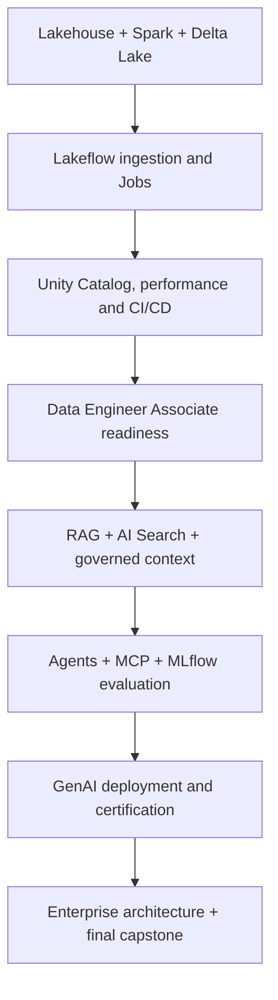

# Databricks Data & AI Engineering — 8-Week Intensive Bootcamp

> **English first · [繁體中文在下](#traditional-chinese)**  
> **8 weeks · 56 daily lessons · 120 hours · Official Databricks certification preparation**

  

An independent, open-source, hands-on roadmap for Databricks Lakehouse, PySpark, Delta Lake, Lakeflow, Unity Catalog, CI/CD, GenAI/RAG, agents, MLflow evaluation and enterprise data-and-AI architecture.

**Suggested dates:** October 26 – December 20, 2026, or start any time. **15 hours/week:** weekdays 2 hours, Saturday 4 hours, Sunday 1 hour.

## Learning architecture

## Weekly learning roadmap

| Week | Focus | Curriculum |
|---|---|---|
| 1 | Lakehouse, SQL, Delta & PySpark | [Week 01](curriculum/week-01.md) |
| 2 | Lakeflow ingestion, pipelines & jobs | [Week 02](curriculum/week-02.md) |
| 3 | Unity Catalog, governance, performance & CI/CD | [Week 03](curriculum/week-03.md) |
| 4 | Data Engineer Associate certification sprint | [Week 04](curriculum/week-04.md) |
| 5 | GenAI, RAG and governed retrieval | [Week 05](curriculum/week-05.md) |
| 6 | Agents, MCP, MLflow & evaluation | [Week 06](curriculum/week-06.md) |
| 7 | GenAI deployment & certification sprint | [Week 07](curriculum/week-07.md) |
| 8 | Enterprise architecture and final capstone | [Week 08](curriculum/week-08.md) |

### Accenture courses, sections and certifications

The [employer-provided course coverage matrix](docs/accenture-course-coverage.md) maps every visible Accenture training topic (including SQL Analytics, AI/BI, Streaming, Privacy, Performance, Lakeflow and GenAI) to particular daily labs. [Professional & Context Engineer follow-on sprint](docs/professional-and-context-followon.md) adds preparation beyond the original eight-week foundation.

## All 56 daily lessons

- [Day 01 — Workspace, compute and SQL warehouses](curriculum/day-01.md)
- [Day 02 — Lakehouse and Medallion architecture](curriculum/day-02.md)
- [Day 03 — PySpark DataFrame operations](curriculum/day-03.md)
- [Day 04 — Delta Lake reliability](curriculum/day-04.md)
- [Day 05 — Databricks SQL and query plans](curriculum/day-05.md)
- [Day 06 — Week 1 Medallion pipeline lab](curriculum/day-06.md)
- [Day 07 — Week 1 review and architecture defense](curriculum/day-07.md)
- [Day 08 — Incremental ingestion and Auto Loader](curriculum/day-08.md)
- [Day 09 — Lakeflow Connect and ingestion design](curriculum/day-09.md)
- [Day 10 — Declarative pipelines and expectations](curriculum/day-10.md)
- [Day 11 — Lakeflow Jobs orchestration](curriculum/day-11.md)
- [Day 12 — Schema evolution and quarantine](curriculum/day-12.md)
- [Day 13 — Incremental ETL production lab](curriculum/day-13.md)
- [Day 14 — Week 2 incident simulation](curriculum/day-14.md)
- [Day 15 — Unity Catalog object model](curriculum/day-15.md)
- [Day 16 — Governance, lineage and RBAC](curriculum/day-16.md)
- [Day 17 — Sensitive data and row/column restrictions](curriculum/day-17.md)
- [Day 18 — Spark execution and performance](curriculum/day-18.md)
- [Day 19 — Bundles and Git-based deployment](curriculum/day-19.md)
- [Day 20 — Governed pipeline challenge](curriculum/day-20.md)
- [Day 21 — DE Associate gap check](curriculum/day-21.md)
- [Day 22 — Exam domain: platform and ingestion](curriculum/day-22.md)
- [Day 23 — Exam domain: transformation and modeling](curriculum/day-23.md)
- [Day 24 — Exam domain: Lakeflow orchestration](curriculum/day-24.md)
- [Day 25 — Exam domain: governance and CI/CD](curriculum/day-25.md)
- [Day 26 — Timed readiness exercise](curriculum/day-26.md)
- [Day 27 — Production pipeline code review](curriculum/day-27.md)
- [Day 28 — Voucher and exam readiness review](curriculum/day-28.md)
- [Day 29 — GenAI platform and model serving](curriculum/day-29.md)
- [Day 30 — Document parsing and chunking](curriculum/day-30.md)
- [Day 31 — Embeddings and vector retrieval](curriculum/day-31.md)
- [Day 32 — Hybrid search and reranking](curriculum/day-32.md)
- [Day 33 — RAG, citations and structured data](curriculum/day-33.md)
- [Day 34 — Governed finance RAG integration lab](curriculum/day-34.md)
- [Day 35 — Retrieval evaluation review](curriculum/day-35.md)
- [Day 36 — Agent orchestration and tool calling](curriculum/day-36.md)
- [Day 37 — MCP and Unity Catalog tool boundaries](curriculum/day-37.md)
- [Day 38 — MLflow experiments and agent traces](curriculum/day-38.md)
- [Day 39 — Evaluation datasets and graders](curriculum/day-39.md)
- [Day 40 — AI Gateway, governance and operations](curriculum/day-40.md)
- [Day 41 — Agent integration challenge](curriculum/day-41.md)
- [Day 42 — Architecture comparison Claude vs Databricks](curriculum/day-42.md)
- [Day 43 — Serving APIs and identity](curriculum/day-43.md)
- [Day 44 — Development, staging and release gates](curriculum/day-44.md)
- [Day 45 — Monitoring, latency and cost](curriculum/day-45.md)
- [Day 46 — AI security and approval controls](curriculum/day-46.md)
- [Day 47 — GenAI Associate readiness](curriculum/day-47.md)
- [Day 48 — Live production-style agent demo](curriculum/day-48.md)
- [Day 49 — Voucher process and exam checkpoint](curriculum/day-49.md)
- [Day 50 — Lakehouse architecture and workload design](curriculum/day-50.md)
- [Day 51 — Context engineering and agent memory](curriculum/day-51.md)
- [Day 52 — Enterprise security and tenant boundaries](curriculum/day-52.md)
- [Day 53 — Performance, FinOps and SLA planning](curriculum/day-53.md)
- [Day 54 — Client architecture and delivery pack](curriculum/day-54.md)
- [Day 55 — Final end-to-end architecture demo](curriculum/day-55.md)
- [Day 56 — Next certifications roadmap](curriculum/day-56.md)

Each day includes named official learning paths, topic-level reference links, a precise time budget, practical lab, success criteria and bilingual instructions. Partner Academy internal lesson URLs require company login and are not invented here.

## Certification roadmap and Accenture process

**Company-announced certifications:** Data Engineer Associate, Data Engineer Professional and Generative AI Engineering with Databricks.

**Recommended extras:** Context Engineer Associate; AWS Platform Architect **Accreditation**; ML Engineer Associate if relevant. Eligibility and employer voucher coverage are **not** confirmed for extra credentials.

- [Certification roadmap, Workday registration, Co-Lab and voucher checklist](docs/certifications.md)
- [Exact company course → days → labs → certification map](docs/accenture-course-coverage.md)
- [Official Databricks certification catalog](https://www.databricks.com/learn/training/certification)
- [Official role-based learning pathways](https://www.databricks.com/learn/training/home)
- [Databricks Partner Academy](https://partner-academy.databricks.com/) (authorized corporate access)

## Practical project and supporting docs

- [Governed Financial Lakehouse + AI Agent capstone](docs/capstone.md)
- [56-day progress tracker](docs/progress-tracker.md)
- [Enterprise architecture & security](docs/architecture.md)
- [Assessment rubric](docs/assessment.md)
- [Weekly 15-hour routine](docs/study-routine.md)
- [Contributing](CONTRIBUTING.md) · [MIT License](LICENSE)

> Independent community study plan; not affiliated with or endorsed by Databricks or Accenture. Use **public/synthetic data only**. Do not commit company secrets, restricted Partner Academy materials, client records or exam questions.

---

# Databricks Data & AI Engineering — 八週高強度實戰計畫

> **56 天完整課表 · 120 小時 · 英文在上、繁體中文在下**

學習 **Databricks Lakehouse、PySpark、Delta Lake、Lakeflow、Unity Catalog、Data Governance、RAG、AI Agents、MLflow Evaluation 以及企業級 Solution Architecture**，以官方課程、實作和正式認證準備為核心。

**建議日期：** 2026/10/26–12/20，亦可隨時開始。**每週 15 小時：** 週一至五每天 2 小時、週六 4 小時、週日 1 小時。

## 八週架構

| 週次 | 學習主題 | 課表 |
|---|---|---|
| 1 | Lakehouse、SQL、Delta、PySpark | [Week 01](curriculum/week-01.md) |
| 2 | Lakeflow 匯入、Pipelines、Jobs | [Week 02](curriculum/week-02.md) |
| 3 | Unity Catalog、治理、效能、CI/CD | [Week 03](curriculum/week-03.md) |
| 4 | Data Engineer Associate 認證衝刺 | [Week 04](curriculum/week-04.md) |
| 5 | GenAI、RAG、治理式檢索 | [Week 05](curriculum/week-05.md) |
| 6 | Agents、MCP、MLflow、Evaluation | [Week 06](curriculum/week-06.md) |
| 7 | GenAI 部署與認證衝刺 | [Week 07](curriculum/week-07.md) |
| 8 | 企業架構、客戶交付與 Capstone | [Week 08](curriculum/week-08.md) |

### Accenture 公司課程與認證逐日對照

[Accenture 公司提供的所有課程 → Daily Plan 對照表](docs/accenture-course-coverage.md)，含 AI/BI、SQL Analytics、Streaming、Privacy、Performance、Lakeflow 和 GenAI；[DE Professional／Context Engineer 進階四週學習](docs/professional-and-context-followon.md)。

## 56 天每日學習計畫

- [Day 01：Workspace、Compute 與 SQL Warehouse](curriculum/day-01.md)
- [Day 02：Lakehouse 與 Medallion 架構](curriculum/day-02.md)
- [Day 03：PySpark DataFrame 操作](curriculum/day-03.md)
- [Day 04：Delta Lake 可靠性](curriculum/day-04.md)
- [Day 05：Databricks SQL 與查詢計畫](curriculum/day-05.md)
- [Day 06：第一週 Medallion Pipeline 實作](curriculum/day-06.md)
- [Day 07：第一週複習與架構答辯](curriculum/day-07.md)
- [Day 08：增量匯入與 Auto Loader](curriculum/day-08.md)
- [Day 09：Lakeflow Connect 與匯入架構](curriculum/day-09.md)
- [Day 10：Declarative Pipelines 與資料品質規則](curriculum/day-10.md)
- [Day 11：Lakeflow Jobs 工作排程](curriculum/day-11.md)
- [Day 12：Schema Evolution 與隔離區](curriculum/day-12.md)
- [Day 13：增量 ETL 上線模擬](curriculum/day-13.md)
- [Day 14：第二週故障演練](curriculum/day-14.md)
- [Day 15：Unity Catalog 物件模型](curriculum/day-15.md)
- [Day 16：治理、Lineage 與 RBAC](curriculum/day-16.md)
- [Day 17：敏感資料與行列權限](curriculum/day-17.md)
- [Day 18：Spark 執行效能](curriculum/day-18.md)
- [Day 19：Bundles 與 Git 部署](curriculum/day-19.md)
- [Day 20：受治理 Pipeline 挑戰](curriculum/day-20.md)
- [Day 21：Data Engineer Associate 能力盤點](curriculum/day-21.md)
- [Day 22：考綱：平台與資料匯入](curriculum/day-22.md)
- [Day 23：考綱：轉換與資料模型](curriculum/day-23.md)
- [Day 24：考綱：Lakeflow 工作排程](curriculum/day-24.md)
- [Day 25：考綱：治理與 CI/CD](curriculum/day-25.md)
- [Day 26：限時應試能力評估](curriculum/day-26.md)
- [Day 27：Production Pipeline 程式碼審查](curriculum/day-27.md)
- [Day 28：Voucher 與認證準備確認](curriculum/day-28.md)
- [Day 29：GenAI 平台與模型服務](curriculum/day-29.md)
- [Day 30：文件解析與切塊](curriculum/day-30.md)
- [Day 31：Embeddings 與向量檢索](curriculum/day-31.md)
- [Day 32：Hybrid Search 與重排序](curriculum/day-32.md)
- [Day 33：RAG、來源引用與結構化資料](curriculum/day-33.md)
- [Day 34：受治理金融 RAG 實作](curriculum/day-34.md)
- [Day 35：檢索評估與回顧](curriculum/day-35.md)
- [Day 36：Agent 協調與工具呼叫](curriculum/day-36.md)
- [Day 37：MCP 與 UC 工具權限](curriculum/day-37.md)
- [Day 38：MLflow 實驗與 Agent Tracing](curriculum/day-38.md)
- [Day 39：Evaluation 資料集與評分器](curriculum/day-39.md)
- [Day 40：AI Gateway、治理與營運](curriculum/day-40.md)
- [Day 41：Agent 整合實戰](curriculum/day-41.md)
- [Day 42：Claude 與 Databricks 架構比較](curriculum/day-42.md)
- [Day 43：Serving API 與身分驗證](curriculum/day-43.md)
- [Day 44：開發、測試與版本發佈](curriculum/day-44.md)
- [Day 45：監控、延遲與成本](curriculum/day-45.md)
- [Day 46：AI 安全與人工核准](curriculum/day-46.md)
- [Day 47：GenAI Associate 認證準備](curriculum/day-47.md)
- [Day 48：Production Agent 實戰展示](curriculum/day-48.md)
- [Day 49：Voucher 與考試準備確認](curriculum/day-49.md)
- [Day 50：Lakehouse 架構與負載設計](curriculum/day-50.md)
- [Day 51：Context Engineering 與 Agent Memory](curriculum/day-51.md)
- [Day 52：企業安全與租戶邊界](curriculum/day-52.md)
- [Day 53：效能、FinOps 與 SLA](curriculum/day-53.md)
- [Day 54：客戶架構與交付文件](curriculum/day-54.md)
- [Day 55：最終端到端架構展示](curriculum/day-55.md)
- [Day 56：下一階段證照路線](curriculum/day-56.md)

每一天都有指定官方學習路線、文件連結、時間分配、動手實作及驗收；公司 Partner Academy 需要登入，內部課程連結不會憑空猜測。

## 認證與公司行政流程

截圖列出 **Data Engineer Associate、Data Engineer Professional、Generative AI Engineering Certification**。我另外建議研究 **Context Engineer Associate** 和 **AWS Platform Architect Accreditation**，但是否提供 Voucher 須向公司確認。

- [證照規劃與 Workday／Co-Lab／Voucher 申請](docs/certifications.md)
- [Databricks 官方認證目錄](https://www.databricks.com/learn/training/certification)
- [官方課程目錄](https://www.databricks.com/learn/training/home)
- [Databricks Partner Academy](https://partner-academy.databricks.com/)

## 專案與其他文件

- [企業金融 Lakehouse + Agent Capstone](docs/capstone.md)
- [56 天學習 Checklist](docs/progress-tracker.md)
- [架構與安全](docs/architecture.md)
- [能力驗收標準](docs/assessment.md)
- [每週 15 小時時間安排](docs/study-routine.md)

> 這是獨立開源計畫，並非 Databricks 或 Accenture 官方背書。不可提交受限制課程內容、公司資料、客戶資訊、秘密金鑰或正式考題。

[MIT License](LICENSE).
