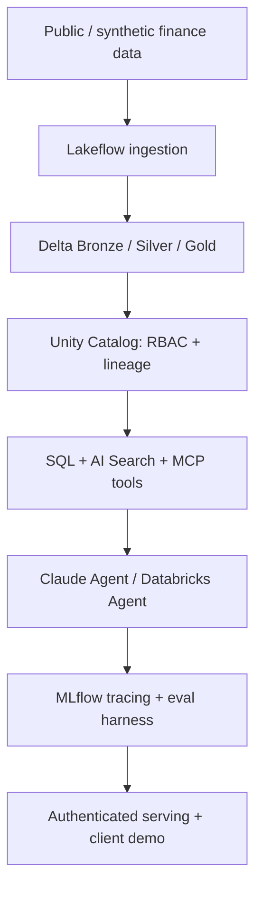

# Capstone — Governed Financial Lakehouse and AI Agent

## Goal

Build a governed financial-data platform that transforms public/synthetic raw data through Bronze/Silver/Gold, exposes least-privilege analytical tools, supports grounded retrieval, and runs a monitored, evaluated AI agent.

## Deliverables

- Reproducible Bronze/Silver/Gold pipeline with incremental ingestion and data quality checks.
- Governed catalogs and access-denial tests.
- RAG index with source attribution and authorized SQL agent tools.
- Fifty versioned evaluation cases, task outcome graders, security tests and trace reports.
- Staging deployment, configuration-as-code, rollback notes and cost budget.
- Client HLD, ADRs, threat model, ROI/TCO assumptions, RACI and delivery plan.

Use synthetic or public data; no Accenture internal sources, tokens or client information.

---

# Capstone：受治理金融 Lakehouse 與 AI Agent

使用公開或合成金融資料，從 Bronze／Silver／Gold 轉換，到 Unity Catalog 權限與資料血緣，再到文件檢索、SQL/MCP 工具、Claude／Databricks Agent 和 MLflow 評估。

**交付：** 可重現的增量 Pipeline、Data Quality、RBAC 拒絕測試、帶引用的 RAG、至少 50 筆 Eval、Trace、測試部署、Rollback、成本假設與客戶架構文件。

**重要：** 不使用 Accenture 內部資料、客戶文件、密鑰或非公開教材。
